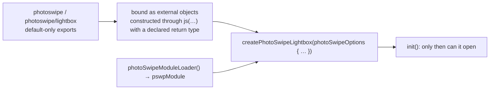

# API overview

## Package layout

| Package | Contents |
| --- | --- |
| `io.github.shijianjs.ktjs.photoswipe` | `PhotoSwipeModule`, `PhotoSwipeLightboxModule`, `createPhotoSwipe`, `createPhotoSwipeLightbox`, `photoSwipeModuleLoader`, `PHOTOSWIPE_STYLESHEET` |
| `…photoswipe.core` | `PhotoSwipeLightbox`, `PhotoSwipeCore`, `PhotoSwipeBase`, `PhotoSwipeOptions`, `photoSwipeOptions` |
| `…photoswipe.core` | `SlideData`, `slideData`, `DataSource`, `ElementProvider`, `ActionType`, `ActionTypes`, `ActionFn`, `Point`, `Padding`, `Bounds`, `point`, `padding` |

## Conventions this wrapper follows

- Both upstream modules have a *default-only* export, and Kotlin/JS compiles an `@JsModule` + `@JsName`
  declaration into a default import. The wrapper binds each sub-path as an external object
  (`import * as photoswipe from 'photoswipe'`) instead, and constructs through typed `js(…)` lambdas.
- A cast back to an `external class` type makes Kotlin/JS emit an `instanceof` against an identifier
  no module exports (`PhotoSwipeLightbox is not defined`); the shims avoid that by declaring the
  lambda's return type, not by casting.
- `PhotoSwipeCore` and `PhotoSwipeLightbox` repeat the members upstream inherits from
  `PhotoSwipeBase`: an `external` class cannot take declared members from an external interface.
  `PhotoSwipeBase` is still declared so the shared shape is documented in one place.
- Union inputs are opaque interfaces with same-name factories: `DataSource(items)` /
  `DataSource(gallery, items)`, `ElementProvider(selector | element | elements)`,
  `ActionType("zoom-or-close")`.
- Options are an `unsafeJso` builder: an unset field stays absent, which matters because upstream
  distinguishes “absent” from an explicit `null` for `dataSource` and `padding`.

## What is deliberately typed loosely

| Member | Kotlin type | Why |
| --- | --- | --- |
| `hideAnimationDuration` / `showAnimationDuration` / `zoomAnimationDuration` | `JsAny?` | upstream is `number \| false` |
| `imageClickAction` / `bgClickAction` / `tapAction` / `doubleTapAction` | `JsAny?` | upstream is `ActionType \| ActionFn \| false` |
| `initialZoomLevel` / `secondaryZoomLevel` / `maxZoomLevel` | `JsAny?` | upstream is `number \| "fit" \| "fill" \| function` |
| `thumbSelector` | `JsAny?` | upstream is `string \| false` |
| `pswpModule` | `JsAny?` | upstream accepts a class, a module object, a promise or a loader |
| event listeners (`on(name, listener)`) | `(JsAny) -> Unit` | every event carries a different augmented payload |

Each of these is recorded in `docs/development/technical-decisions.md`.
