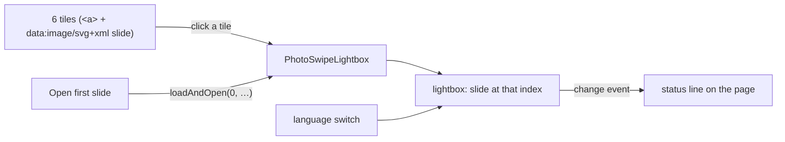

# Demo

The demo lives at [https://shijianjs.github.io/ktjs-photoswipe/demo/](https://shijianjs.github.io/ktjs-photoswipe/demo/).

The demo page mounts six tiles as a real PhotoSwipe gallery: each tile is an `<a>` carrying a
`data:image/svg+xml` slide (so no image has to be fetched), and clicking one opens the lightbox at
that index. The “open first slide” button calls `loadAndOpen(0, …)` directly, the status line follows
the `change` event, and the language switch also rewrites the lightbox's own button titles.

The language button in the page header switches between English and Simplified Chinese: every
visible string changes, not just the title.

The API reference is at [https://shijianjs.github.io/ktjs-photoswipe/api/](https://shijianjs.github.io/ktjs-photoswipe/api/), generated by Dokka from the published modules.
