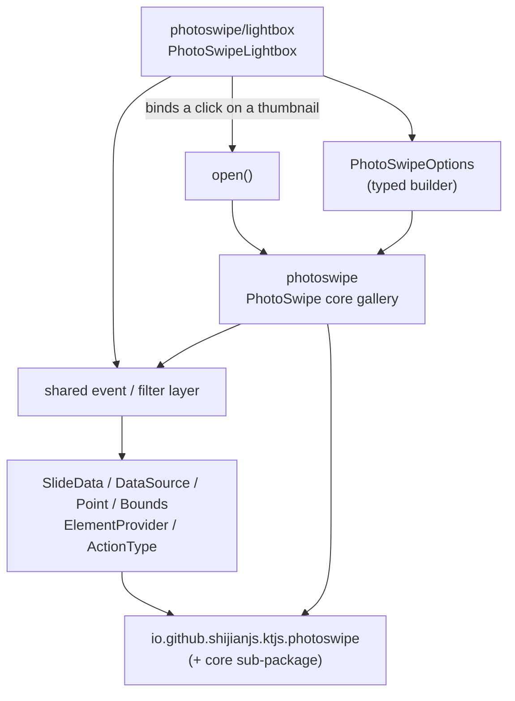

# Introduction

`ktjs-photoswipe` is a Kotlin/JS wrapper for [`photoswipe`](https://github.com/dimsemenov/PhotoSwipe) from [PhotoSwipe](https://github.com/dimsemenov/PhotoSwipe) 5.4.4: every type and member of
the upstream `.d.ts` files becomes an `external` declaration the compiler checks, with no
`dynamic` fallback.

The wrapped surface is the whole `photoswipe` 5 package: the `PhotoSwipeLightbox` layer (`photoswipe/lightbox`) that binds thumbnail clicks and reads their sizes, the `PhotoSwipe` core gallery (`photoswipe`) it opens, the shared event/filter layer both extend, the typed `PhotoSwipeOptions` builder, and the data types (`SlideData`, `DataSource`, `Point`, `Padding`, `Bounds`, `ElementProvider`, `ActionType`).

## What is wrapped

| Module | Gradle artifact | Upstream |
| --- | --- | --- |
| `ktjs-photoswipe` | `io.github.shijianjs:ktjs-photoswipe` | `photoswipe` 5.4.4 (two entry points: `photoswipe` and `photoswipe/lightbox`) |

The package has two sub-path entries, both with a `default` export only; they land in one Kotlin package (`io.github.shijianjs.ktjs.photoswipe`) with a `core` sub-package.

`PhotoSwipeLightbox` is the part a page usually keeps: it owns the thumbnails and reads their sizes,
then opens the core gallery on click — the demo binds six tiles that way.

## License

The wrapper itself is MIT. The upstream `photoswipe` license differs from it — read the
[license notes](guide/license.md) before shipping it commercially.

## Where to go next

- [Getting started](guide/getting-started.md) — add the dependency, make the first call, run the build.
- [API overview](guide/api-overview.md) — package layout, type mapping conventions, common patterns.
- [Demo](guide/demo.md) — see it running in the browser.
