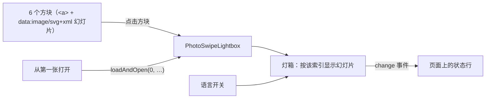

# 演示页

演示页：[https://shijianjs.github.io/ktjs-photoswipe/demo/](https://shijianjs.github.io/ktjs-photoswipe/demo/)

演示页把六个方块挂成一个真实的 PhotoSwipe 画廊：每个方块是一个带 `data:image/svg+xml` 幻灯片的
`<a>`（因此不需要请求任何图片），点击即以该索引打开灯箱。「从第一张打开」按钮直接调用
`loadAndOpen(0, …)`，状态行跟随 `change` 事件，语言开关同时改写灯箱自身按钮的标题。

页面右上角的语言按钮在英文与简体中文之间切换，切换的是页面上全部可见文案（不只是页面标题）。

API 文档在 [https://shijianjs.github.io/ktjs-photoswipe/api/](https://shijianjs.github.io/ktjs-photoswipe/api/)，由 Dokka 从已发布模块生成。
