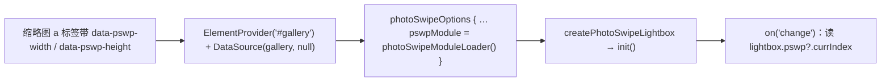

# 快速开始

## 依赖

```kotlin
kotlin {
    js {
        binaries.executable()
        browser()
    }
    sourceSets {
        jsMain.dependencies {
            implementation("io.github.shijianjs:ktjs-photoswipe:5.4.4-kt.1")
            // `kotlin-browser` 的 `web.*` 类型出现在公开 API 里，所以消费方要能编译到它们。
            implementation("org.jetbrains.kotlin-wrappers:kotlin-browser:2026.11.1")
        }
    }
}
```

要求 Kotlin 2.4.21 或更新版本；wrapper 输出 ESM，`es2015` 目标起可用。

## 注册插件

没有插件注册表：PhotoSwipe 5 只有两个模块，而灯箱需要把**核心类**放进 `pswpModule` 选项才能打开任何东西（否则上游 `preload()` 抛 `pswpModule is not valid`）。wrapper 为此提供了 loader：

```kotlin
import io.github.shijianjs.ktjs.photoswipe.createPhotoSwipeLightbox
import io.github.shijianjs.ktjs.photoswipe.photoSwipeModuleLoader

val lightbox = createPhotoSwipeLightbox(
    photoSwipeOptions {
        gallery = ElementProvider("#gallery")
        childSelector = "a"
        pswpModule = photoSwipeModuleLoader()
    },
)
lightbox.init()
```

`photoSwipeModuleLoader()` 返回一个解析已导入核心模块的函数，这也是上游为 ES 模块给出的写法。



## 第一个调用

```kotlin
import io.github.shijianjs.ktjs.photoswipe.createPhotoSwipeLightbox
import io.github.shijianjs.ktjs.photoswipe.core.DataSource
import io.github.shijianjs.ktjs.photoswipe.core.ElementProvider
import io.github.shijianjs.ktjs.photoswipe.core.photoSwipeOptions
import io.github.shijianjs.ktjs.photoswipe.photoSwipeModuleLoader

fun bindGallery(gallery: web.html.HTMLElement) {
    val lightbox = createPhotoSwipeLightbox(
        photoSwipeOptions {
            this.gallery = ElementProvider(gallery)
            childSelector = "a"
            // 灯箱通过 `dataSource` 把锚点变成幻灯片。
            dataSource = DataSource(gallery, null)
            pswpModule = photoSwipeModuleLoader()
            bgOpacity = 0.9
        },
    )
    lightbox.on("change") { /* 读取 lightbox.pswp?.currIndex */ }
    lightbox.init()
}
```

每个缩略图是一个带 `data-pswp-width` 与 `data-pswp-height` 的 `<a href="...">` 锚点 —— PhotoSwipe 从这两个属性读取大图尺寸。

## 构建与测试

```bash
./gradlew build                     # 编译、Detekt、浏览器测试
./gradlew :ktjs-photoswipe:jsBrowserTest     # 只跑 wrapper 的浏览器测试
./gradlew :docs:docusaurusStart     # 文档开发服务器
./gradlew pagesSite                 # 文档在 /，演示在 /demo/，Dokka 在 /api/
```
