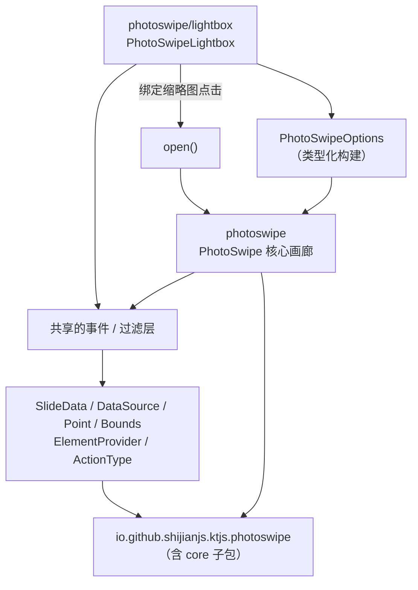

# 简介

`ktjs-photoswipe` 是 [PhotoSwipe](https://github.com/dimsemenov/PhotoSwipe) 生态里 `photoswipe` 5.4.4 的 Kotlin/JS wrapper：上游
`.d.ts` 里的每个类型和成员都落成可被编译器检查的 `external` 声明，不靠 `dynamic` 兜底。

封装范围是 `photoswipe` 5 整包：绑定缩略图点击、读取其尺寸的 `PhotoSwipeLightbox` 层（`photoswipe/lightbox`）、它打开的核心画廊 `PhotoSwipe`（`photoswipe`）、两者共用的事件/过滤器层、带类型的 `PhotoSwipeOptions` 构造器，以及数据类型（`SlideData`、`DataSource`、`Point`、`Padding`、`Bounds`、`ElementProvider`、`ActionType`）。

## 封装了哪些包

| 模块 | Gradle 坐标 | 上游 |
| --- | --- | --- |
| `ktjs-photoswipe` | `io.github.shijianjs:ktjs-photoswipe` | `photoswipe` 5.4.4（两个入口：`photoswipe` 与 `photoswipe/lightbox`） |

包有两个子路径入口，都只有 `default` 导出；它们落在同一个 Kotlin 包（`io.github.shijianjs.ktjs.photoswipe`）及其 `core` 子包。

页面通常只持有 `PhotoSwipeLightbox`：它接管缩略图、读取尺寸，点击时再打开核心画廊 —— 演示页的那六个方块就是这么挂的。

## 许可证

wrapper 自身是 MIT。上游 `photoswipe` 的许可证与 wrapper 不同，商用前请读
[许可证说明](guide/license.md)。

## 接下来

- [快速开始](guide/getting-started.md) — 加依赖、写第一个调用、跑构建。
- [API 概览](guide/api-overview.md) — 包结构、类型映射约定、常用写法。
- [演示页](guide/demo.md) — 浏览器里直接看效果。
